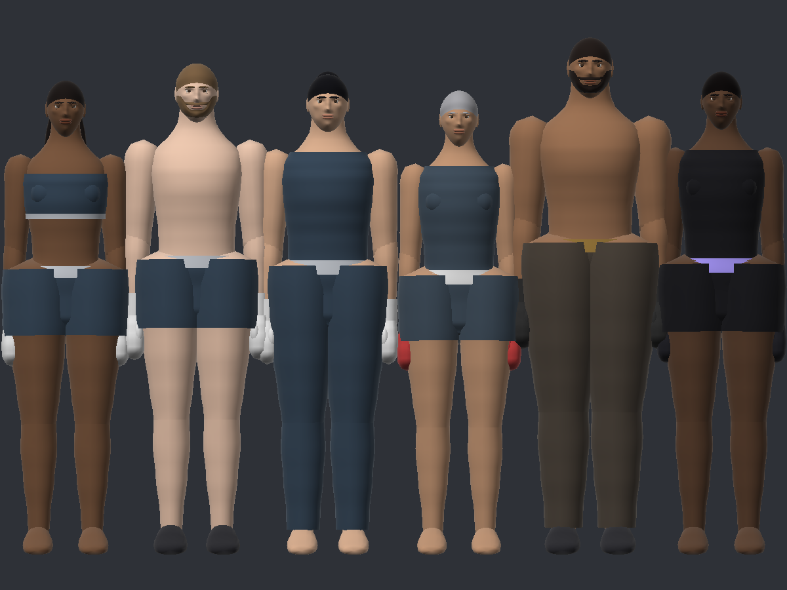
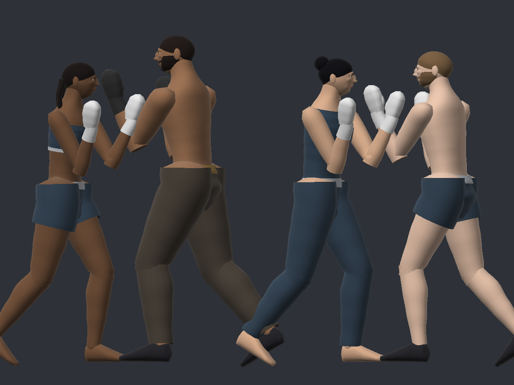
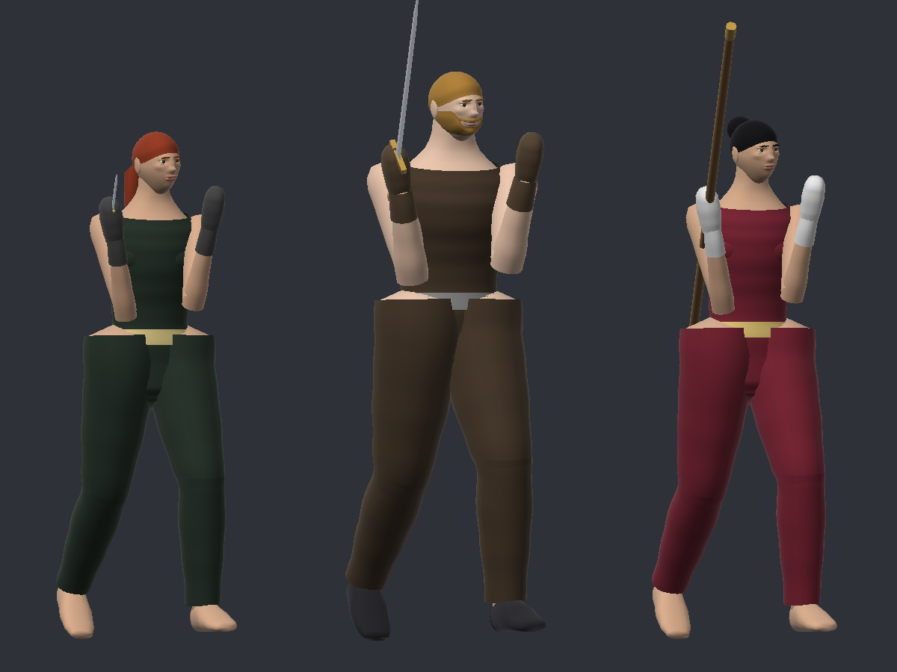

# Undercurrent (internal working title)

An original 2.5D one-on-one martial-arts fighting game for Android (iOS-compatible architecture), built with Unity 6 LTS + URP.
"Undercurrent" is an **internal working title only** — it is not trademark-cleared and a conflicting indie title is known
(see `LEGAL_IP_AUDIT.md`).





> **Honest status:** the gameplay core (combat engine, AI, rounds, progression, saves, tutorial logic) is implemented and
> verified by 112 automated tests. The Unity presentation layer (rendering, UI, input, audio, haptics, build tooling) is
> implemented but **has never been compiled or run inside a Unity Editor**, because no Editor could be installed in the
> development environment. Characters, environments and audio are **code-generated placeholders**, not final art.
> No APK/AAB has been built. Details: `PROGRESS.md`, `KNOWN_ISSUES.md`, `TEST_RESULTS.md`.

## Repository layout

```
UndercurrentGame/
  Assets/Undercurrent/
    Scripts/Core/        Engine-independent game rules (no UnityEngine references; asmdef noEngineReferences=true)
      Combat/            Frame-data model, FighterRuntime state machine, FightSimulation (60 Hz, deterministic)
      AI/                FightAI (reaction-delayed perception), difficulty profiles, boss phases
      Content/           Fighter roster + movesets, campaign/arenas, tutorial script
      Progression/       Save data, rewards, upgrades/skills, cosmetics, achievements, save repository/migration, online-service interfaces
    Scripts/CharacterGen/ Engine-independent procedural human generator, pose library, FK/skinning solver, foot-planting IK
    Scripts/Runtime/     Unity layer: GameApp bootstrap, fight controller, presentation, UI screens, services
    Scripts/Editor/      Project setup, Android build entry points, Animator controller generator
    Tests/EditMode/      NUnit tests (run by Unity Test Runner AND by Tools/CoreTests)
  Tools/
    CoreTests/           .NET 8 test project compiling Core + Tests sources directly
    UnityCompileCheck/   Type-check of Unity-facing code against NON-AUTHORITATIVE API stubs
    CharacterPreview/    Offline preview: exports posed characters; render.py rasterises them to PNG (no Unity needed)
    run_checks.sh        Runs both of the above
  README.md  LEGAL_IP_AUDIT.md  ASSET_LICENSES.md  TEST_RESULTS.md  KNOWN_ISSUES.md  PROGRESS.md
```

Package versions are intentionally **not pinned** in this repository: they could not be verified against Unity's registry
from the development environment. Use the versions that ship with the Unity 6 URP template for your installed Editor.

## Setup (Unity Editor)

1. Install **Unity 6 LTS** (6000.0.x) via Unity Hub with **Android Build Support** (OpenJDK, Android SDK & NDK).
2. In Unity Hub create a new project from the **URP 3D template** (shown as "Universal 3D" in Unity 6 Hub). This provides
   compatible versions of URP, Input System, uGUI and Test Framework.
3. Close the Editor and copy `UndercurrentGame/Assets/Undercurrent` into the new project's `Assets/` folder.
   (Optional: delete the template's `Assets/Scenes/SampleScene.unity`.)
4. Reopen the project. Check the Console for compile errors (first real compilation — please report any).
5. Run **Undercurrent ▸ Setup Project**. It creates:
   - `Assets/Undercurrent/Resources/Undercurrent/Materials/{BaseLit,BaseUnlit,BaseParticle}.mat` (guarantees shaders ship in builds),
   - `Assets/Undercurrent/Scenes/Boot.unity` and sets it as the only build scene,
   - landscape / IL2CPP / ARM64 / ASTC player settings and a **placeholder** application id `com.undercurrentdev.placeholder`.
6. Open `Assets/Undercurrent/Scenes/Boot.unity` and press **Play**. The game builds itself at runtime (`GameApp` boots after
   scene load). Set the Game view to a landscape resolution such as 1920×1080 or 2400×1080.
7. Commit the generated `.meta` files after the first import so GUIDs stay stable.

### Controls in the Editor
Touch controls are on screen (mouse works). Keyboard: **A/D** or arrows move, **W** jump, **S** crouch, **J** LP, **K** HP,
**U** LK, **I** HK, **L** block, **Space** dodge, **O** parry, **H** throw, **N** special, **Esc** pause/back.
Gamepad (Input System): stick/d-pad, West LP, North HP, South LK, East HK, RB block, RT dodge, LB parry, LT throw,
stick-click special, Start pause.

## Running tests

- **Inside Unity:** Window ▸ General ▸ Test Runner ▸ EditMode ▸ Run All (assembly `Undercurrent.Tests.EditMode`).
- **Without Unity (CI/agents):** requires the .NET 8 SDK.
  ```bash
  UndercurrentGame/Tools/run_checks.sh
  # or individually:
  dotnet test UndercurrentGame/Tools/CoreTests/Undercurrent.Core.Tests.csproj
  dotnet test UndercurrentGame/Tools/CoreTests/Undercurrent.Core.Tests.csproj --filter "FullyQualifiedName~BalanceReport" \
      --logger "console;verbosity=detailed"     # AI-vs-AI balance diagnostics (explicit test)
  ```

## Building for Android

From the menu: **Undercurrent ▸ Build ▸ Android Debug APK** → `Builds/Android/Undercurrent-debug.apk`.

Batch mode (CI):
```bash
Unity -batchmode -quit -projectPath <project> \
  -executeMethod Undercurrent.EditorTools.BuildScript.BuildAndroidDebugApk -logFile Builds/build-debug.log
```

Release App Bundle (signing credentials come from environment variables and are cleared from ProjectSettings afterwards):
```bash
export UC_KEYSTORE_PATH=/secure/undercurrent.keystore UC_KEYSTORE_PASS=... UC_KEY_ALIAS=... UC_KEY_PASS=...
Unity -batchmode -quit -projectPath <project> \
  -executeMethod Undercurrent.EditorTools.BuildScript.BuildAndroidReleaseAab -logFile Builds/build-release.log
```
The build script exits non-zero unless Unity's `BuildReport` reports success **and** the output file exists.
Replace the placeholder application id before any store upload.

## Game modes and campaign

- **30-level campaign** in 6 chapters, each with its own arena, ending in a best-of-5 final boss. Levels earn up to 3 stars
  (win + objectives), unlock fighters and put weapons on sale.
- **Difficulty tiers:** every level is **Easy, Medium, Hard or Extreme** (mixed inside each chapter). The tier sets the AI's
  skill, scales the opponent's health and damage, and multiplies the Coins the level pays.
- **Power:** one number for your loadout (100 = fresh, unarmed). Each level shows a **recommended power**; the campaign
  card, briefing and defeat screen compare it with yours. Power comes from fighter level (+2% health and damage per level),
  armour (5 tiers, up to 25% less damage taken) and your weapon (+25% when armed, +6% per weapon level).
- **Coins & Shop:** Coins are earned from wins (first clear, replays at half reward), objectives, awards, Versus wins (more
  per round against harder AI) and a small purse when you lose after winning a round. Spend them in the **Shop** on armour,
  weapons (each goes on sale after its story level) and weapon/fighter upgrades. **Coin packs** can be bought for real money
  once Play Billing is configured; until then the Coins tab says so (development builds use clearly-labelled test purchases).
  A simulated free player can reach every level's recommended power without paying (see `TEST_RESULTS.md` §2b).
- **Level formats:** Standard duels, **Weapons** levels (armed opponent or armed duel), and **Gauntlets** (3–5 opponents in a
  row; health carries over with 25–30 % recovery between bouts). Some levels add rules: Last Breath (every round starts at
  40 % health), Exhaustion (half-speed stamina for both), Iron Body (your strikes deal 80 %), Forge Trial (opponent +15 %).
- **Weapons:** knife (fast, short, extra counter-hit damage), sword (balanced, strong slashes), staff (longest reach, slow).
  Weapons replace the punch buttons and the special; kicks and throws stay. Simultaneous strikes **clash**; a guard break or
  throw **disarms** the opponent for 5 s. Buy, upgrade and equip weapons in the Armory or Shop; Versus lets both sides pick a weapon.

## Characters

Fighters are **procedurally generated humans** (`Scripts/CharacterGen/HumanBodyGenerator.cs`): one continuous skinned
mesh per fighter with anatomical proportions, muscle profiles, a sculpted head (eyes with lids, brows, nose, lips, ears),
hair styles, beards and clothing layers that share the body's skin weights. Joint rotations come from the pose library
and **foot-planting IK** (`PoseGrounding.cs`) keeps feet on the floor in every grounded state. Detail scales with the
graphics tier (≈11k triangles on Low, ≈29k on High per fighter).

They are clearly human but stylised (flat colours, no skin textures or facial animation). For photoreal fighters, use the
licensed-model path below; both paths share the same skeleton/state names.

Preview without Unity (renders PNGs from the exact runtime code):
```bash
cd UndercurrentGame/Tools/CharacterPreview
dotnet run -- /tmp/preview mara:guard:90 rook:guard:-90     # fighterId:pose:yaw (pose = rest, guard, crouch, block, jab, frontkick, …)
python3 render.py /tmp/preview/stance.png --side /tmp/preview/mara_guard_90.mesh /tmp/preview/rook_guard_-90.mesh
```

## Integrating licensed character models

Typical sources for realistic humans: MakeHuman / MPFB (check the licence of the assets you export), Adobe Mixamo
characters and martial-arts animation clips, Reallusion Character Creator, or commissioned scans. **Read and record each
licence** (game use, mobile distribution, modification) before shipping.

1. Import an FBX/glTF humanoid with a **Humanoid** avatar (commercially licensed; record it in `ASSET_LICENSES.md`).
2. Put its clips in a folder named after the fighter id (`mara`, `dima`, `haruto`, `ines`, `rook`, `sable`). Name clips after
   the states the game requests: `Idle`, `WalkForward`, `WalkBack`, `Crouch`, `Blocking`, `HitStun`, `KnockedDown`, …,
   and `Attack_<animationId>` per move (e.g. `Attack_jab`, `Attack_roundhouse`).
3. Select the folder ▸ **Undercurrent ▸ Characters ▸ Build Animator Controller From Selected Clip Folder**. Missing clips are listed.
4. Make a prefab (model + Animator with that controller) at `Assets/Undercurrent/Resources/Undercurrent/Characters/<fighterId>.prefab`.
   `FighterView` uses it automatically instead of the placeholder mannequin. Attack clips are scrubbed to the
   simulation's frame counter, so the hit lands on the frame the combat data says regardless of clip length.

Licensed audio: place clips at `Assets/Undercurrent/Resources/Undercurrent/Audio/<id>` (ids listed in
`Scripts/Runtime/Services/ProceduralAudio.cs`); they override the procedural placeholders.

## Architecture notes

- **Simulation is authoritative.** `FightSimulation` steps at 60 Hz from `FrameInput` only; damage is applied only when an
  active hitbox overlaps a hurtbox and the defender's state allows it. Presentation reads state and per-tick events.
- **Determinism:** fixed tick, seeded AI RNG, no Unity time or physics inside the core (tested by state hashing).
- **AI fairness:** `FightAI` records what is visible about the opponent and decides from the observation
  `ReactionTicks` ago (≥ 12 ticks = 200 ms at every difficulty); it never reads the opponent's controller input.
- **Offline first:** progress is saved locally (`persistentDataPath/undercurrent_save.json`, atomic write + `.bak`).
  Billing, cloud save, leaderboards and accounts are interfaces with explicit *NotConfigured* implementations.
